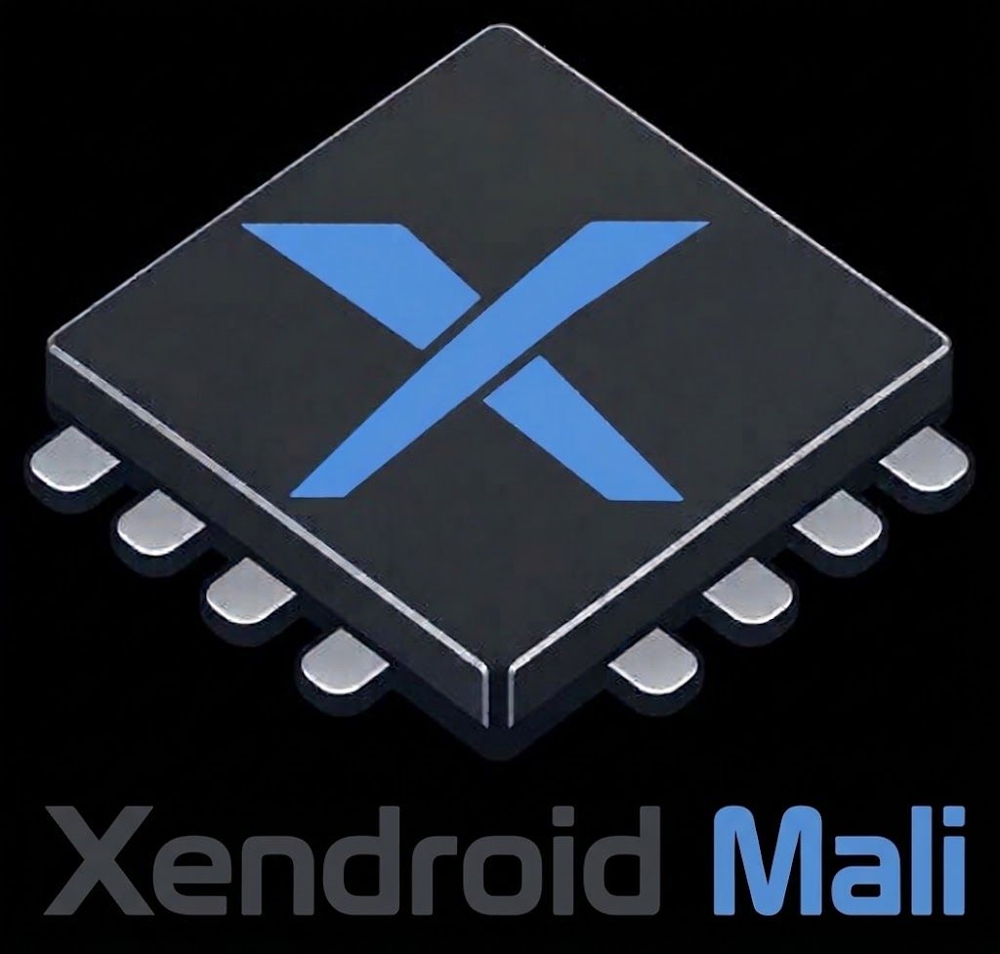

<p align="center">
  <picture>
    <source media="(prefers-color-scheme: dark)" srcset="docs/assets/xendroid-mali-logo-dark.png">
    
  </picture>
</p>

<p align="center"><strong>Xbox 360 emulation on Android, tuned for Mali.</strong></p>

<p align="center"><b>English</b></p>

---

**Xendroid-Mali** is an Xbox 360 emulator for Mali GPUs, based on the XenDroid+ project and [Xenia](https://github.com/xenia-project/xenia).

> [!NOTE]
> Xendroid-Mali is experimental. How a game runs depends on the game, the device, and the GPU hardware: some titles run well, while others still show glitches or do not boot.

## Highlights

### A new interface
- **Library** with search by name or Title ID, favorites, sorting, play time, and
  *Recently played*, fully usable with a controller.
- **In-game menu** with graphics, HUD, controls, and session pages, opened from the
  touch handle, Back/Guide, or the shoulder buttons.
- **First-run assistant**, gamer profiles, save backup and restore, title update, and DLC installation.
- **Touch controls** with a layout editor and optional adaptive sticks.

### Performance & Accuracy
- **Per-game settings** applied when a title starts for heavy titles like Forza Horizon, Gears of War 3, Crysis 3, and more.
- **Fewer EDRAM transfers** on the host GPU: transfer and draw overwrites are skipped.
- **ARM64 JIT work**: cheap exact NaN handling, ABA-safe guest reservations, and VMX denormal flushing.
- **Asynchronous shader compilation** with a persistent pipeline cache.
- **Audio hiccups** fade out and back in instead of clicking, on AAudio and OpenSL ES.

### Tools
- **Performance HUD** (FPS, frame time, CPU, GPU, RAM, temperatures) and per-game frame-rate limits (unlimited, or 30 to 120 FPS).
- **Play history** with frame-time percentiles, a diagnostics bundle to share, local compatibility notes, and community settings profiles.

---

## Compatibility

| SoC / Chipset | Status | Notes |
| :--- | :--- | :--- |
| **MediaTek Dimensity 8350** | ✅ Fully Working | Confirmed fully functional, stable, and tested. |
| **MediaTek Dimensity 8400** | ⚠️ Known Issues | Currently experiences 3D geometry rendering glitches; fixes coming in upcoming updates. |
| **Other SoCs / Chipsets** | ❓ Untested | Has not been tested yet. Performance and compatibility on other SoCs may vary. |

---

## Requirements

- Android 10 or newer on 64-bit ARM (`arm64-v8a`).
- A Vulkan-capable Mali GPU.
- Your own Xbox 360 games, dumped from discs or consoles you own: disc images (ISO), ZAR archives, or Games on Demand (GOD) packages.

## Getting started

1. Install the Xendroid-Mali APK.
2. Open it and follow the first-run assistant to set up your games folder.
3. Choose a game in the library. While playing, open the in-game menu from the touch handle or with Back/Guide on a controller.

## Building from source

Xendroid-Mali builds with JDK 21, the Android SDK and NDK, and the SPIR-V shader toolchain ([BUILD.md](BUILD.md)):

```sh
./gradlew :app:assembleRelease
